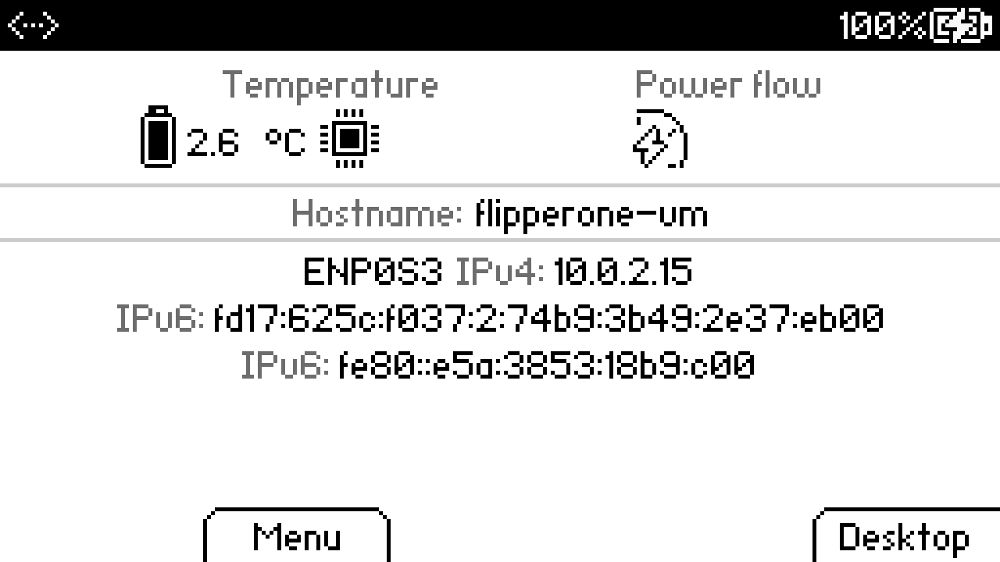
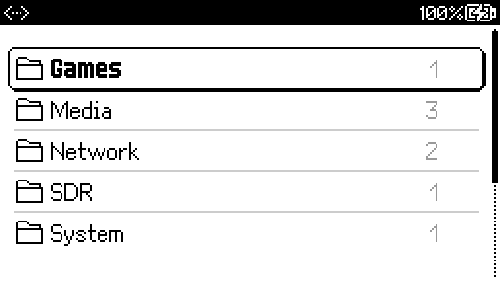
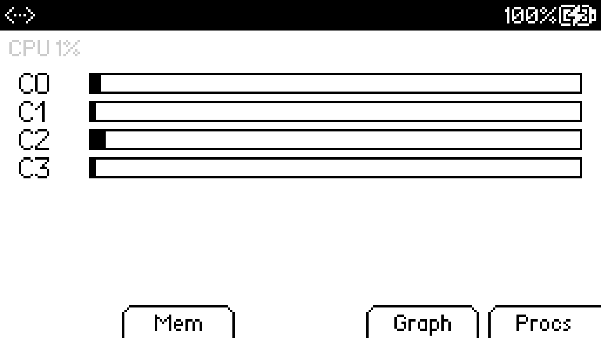
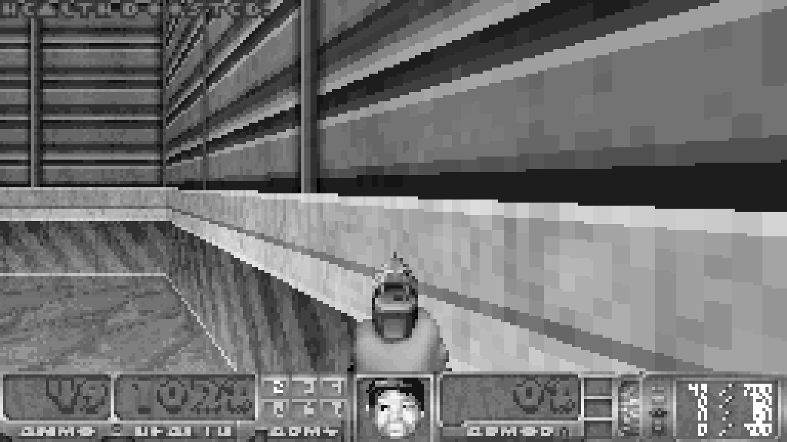
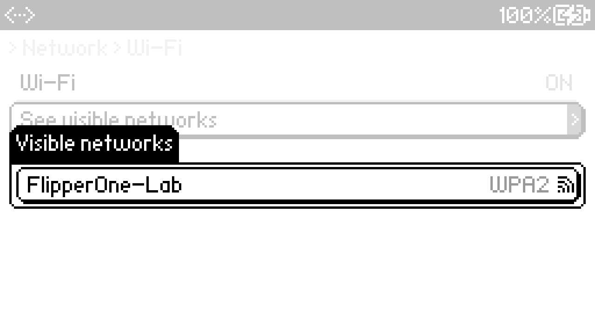
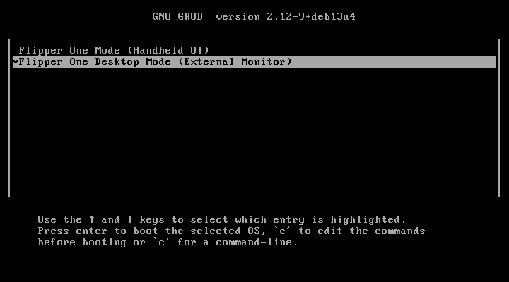
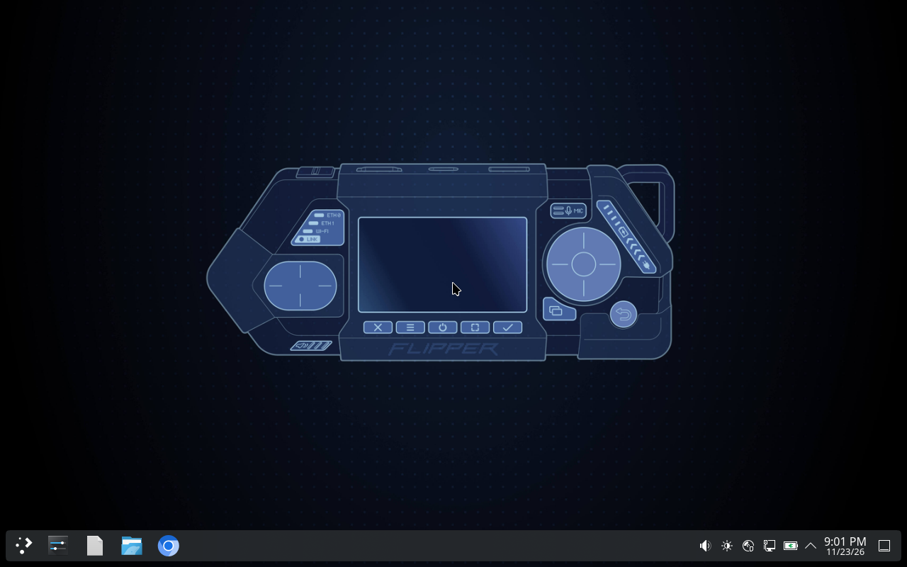

# FlipperOneISO

A bootable **x86_64 live ISO of the Flipper One OS** for VirtualBox or VMware. It is
Debian 13 (trixie) with Flipper's own UI, **flipctl**, compiled for x86_64, Flipper's own
prebuilt apps, and two boot modes:

- **Flipper One Mode (Handheld UI)**: flipctl alone on screen, scaled up by whole pixels,
  with the PC keyboard and mouse acting as the Flipper's buttons.
- **Flipper One Desktop Mode (External Monitor)**: Flipper's KDE Plasma desktop profile,
  with flipctl running in the background and its browser view on `http://localhost:8899`.

Everything Flipper-made comes from Flipper's repositories, unmodified, at the commits in
`build.sh`:

| Repository | Used for |
|---|---|
| [flipperone-linux-build-scripts](https://github.com/flipperdevices/flipperone-linux-build-scripts) | package lists, `overlays/` (configs, KDE profile, wallpaper) |
| [flipctl-slint](https://github.com/flipperdevices/flipctl-slint) | flipctl, built natively for x86_64 with the same features as the device |
| [flipctl-apps](https://github.com/flipperdevices/flipctl-apps) | the app catalogue; its prebuilt apps are baked into the ISO |

This repository adds only the amd64 build and `overlays/amd64-vm`.

*An unofficial community project, not made or supported by Flipper Devices.*

---

## Preview

All screenshots are from the ISO running in VirtualBox.

### Handheld mode

The Flipper One's 256x144 screen at 5x, driven by the keyboard and mouse.

| | |
|---|---|
|  |  |
| **Home screen**: battery, hostname and network | **Apps**: Flipper's prebuilt apps, by folder |
|  |  |
| **System Monitor**, one of Flipper's ARM apps, emulated | **Doom** (Freedoom), playable |
|  |  |
| **Wi-Fi**: the simulated FlipperOne-Lab network | **Boot menu**: handheld or desktop mode |

### Desktop mode

Flipper's KDE Plasma profile: Breeze Dark, the Flipper One wallpaper, and autologin.



---

## What you need

- A 64-bit (x86_64) PC with **8 GB RAM** or more
- **20 GB free disk space** for the build
- An internet connection: the build downloads about 3 GB (Debian, KDE, Flipper's code and
  apps)
- Either **Windows 10/11** (the build runs in WSL2) or a **Debian 13** machine
- **VirtualBox** or **VMware** to run the result

The first build takes about **20 to 40 minutes**, mostly downloading and installing Debian
and KDE.

---

## Build on Windows (WSL2)

### 1. Install WSL2 with Debian

Open **PowerShell as Administrator** (right-click Start, then *Terminal (Admin)*) and run:

```powershell
wsl --install -d Debian
```

If it asks you to, **restart Windows**, then open **Debian** from the Start menu. The first
time it starts, it asks you to pick a **Linux username and password**; remember the
password, since `sudo` asks for it.

> If `wsl` fails with `REGDB_E_CLASSNOTREG` or "installation appears to be corrupted", run
> `wsl --update` in an Administrator PowerShell, restart, and try again.

Check you have Debian 13 on WSL version 2:

```powershell
wsl -l -v                          # Debian ... VERSION 2
wsl -d Debian cat /etc/debian_version   # 13.x
```

### 2. Build

In the **Debian** window (not PowerShell):

```sh
sudo apt update && sudo apt install -y git
cd ~
git clone https://github.com/Armand220/FlipperOneISO.git
cd FlipperOneISO
sudo ./setup-host.sh     # once: build tools, and Rust from trixie-backports
sudo ./build.sh
```

Clone into your Linux home (`cd ~`), **not** into `/mnt/c/...`. The build needs Linux file
permissions, and refuses to run from a Windows drive.

When it finishes, the ISO is on your **Windows Desktop** as `flipperone-amd64.iso`.

---

## Build on Debian 13

The same commands as above, from *2. Build*. The ISO is written to
`src/flipperone-linux-build-scripts/out/flipperone-amd64.iso`. To have it copied somewhere,
run `sudo EXPORT_DIR=/some/dir ./build.sh`.

---

## Rebuilding

Run `sudo ./build.sh` again. It reuses the downloaded sources, the Rust build and the app
downloads in `src/`, so later builds take about 10 to 15 minutes. `src/` is created by root,
so remove it with `sudo rm -rf src` when you want to start over or free the space.

`build.sh` builds Flipper's code at the commits it pins (the `PINS` list). Moving a pin to a
newer commit can break the build if Flipper has changed their overlays or package lists;
`build-iso-amd64.sh` stops with an error naming what moved.

---

## Run it in a VM

### VirtualBox

1. **New** VM: type **Linux**, version **Debian (64-bit)**.
2. **Memory 4096 MB** (2048 is enough for handheld mode only), **2 or more CPUs**.
3. **Do not add a virtual hard disk.** It runs live, from RAM.
4. **Settings → Display:** graphics controller **VMSVGA**, video memory **128 MB**.
5. **Settings → Storage:** put `flipperone-amd64.iso` in the optical drive.
6. Start it.

### VMware Workstation / Player

Create a new VM from the ISO, choose **Linux / Debian 12.x 64-bit** (or *Other Linux 6.x
kernel 64-bit*), give it **4 GB** of memory, and accept the default small disk (it isn't used).

### Booting

GRUB offers **Flipper One Mode (Handheld UI)** (the default after 8 seconds) and **Flipper One
Desktop Mode (External Monitor)**. The login, wherever one is asked for, is **`user` / `user`**.

The Flipper screen appears once the system has finished booting. Under VirtualBox on a
Windows PC with WSL2 or Hyper-V enabled, that can take a minute or two, and keys pressed on
the boot text before then do nothing.

It is a live system, so nothing is saved across reboots.

---

## Controls (handheld mode)

The keycodes are the ones Flipper's input driver sends (`flipctl-slint`,
`crates/flipper-ui/src/key.rs`).

| Flipper One | Keyboard | Mouse |
|---|---|---|
| D-pad | Arrows, or W A S D | wheel (tilt for left/right) |
| OK | Enter, Space | left click |
| Back | Backspace, Esc | right click, thumb button |
| App switcher | Tab, H, Windows key | middle click |
| Soft keys, left to right (Esc, View/Menu, Power, Edit, Run) | Z X C V B | |
| Power | also P, F12 | |
| Push-to-talk | T | |
| Switch to desktop mode | Ctrl+Alt+D | |

- On the home screen only **X** (Menu) and **B** do anything.
- On the text-input screen, the arrows and Enter pick letters, **V** deletes, **X** switches
  to numbers, **B** is Done (once a Wi-Fi password is 8 to 63 characters long), and **Z**
  is Cancel.
- In Doom: arrows move, **Z** fire, **X** next weapon, **V** use, **B** map, **T** menu.
- **Ctrl+Alt+F2** opens a text console.

**Wi-Fi:** Menu → Network → Wi-Fi → See visible networks → **FlipperOne-Lab**, password
**`flipperone`**.

---

## What `overlays/amd64-vm` adds

- **Boot modes**: `flipper-boot-mode` reads `flipper.mode=` from the kernel command line
  and starts `flipper-handheld.service` (sway kiosk + `flipctl --wayland`) or
  `flipper-desktop.target` (sddm + `flipctl --headless`).
- **Keyboard and mouse bridge** (`flipper-kbd-bridge.py`): grabs the VM's keyboard and
  mouse and re-emits them as a `Flipper One Buttons` uinput device.
- **MCU stand-in** (`flipper-mcu-mock.py`): a battery at 100% and charging (the kernel's
  `test_power`, built out of tree because Debian's amd64 kernel lacks it), a
  `Flipper One Software Buttons` device, and a serial CLI on `/dev/ttyFlipperMCU` that
  speaks the MCU firmware's `input dump` / `input send`.
- **Simulated Wi-Fi**: `mac80211_hwsim` radios plus a `FlipperOne-Lab` access point in its
  own network namespace, routed to the VM's internet.
- **Flipper's prebuilt apps**: the catalogue's aarch64 AppImages, run through
  `qemu-user-binfmt`, with a binfmt rule for the AppImage header and the arm64 system
  libraries they expect from the device.

The build uses mmdebstrap and chroot rather than debos, because debos needs `/dev/kvm` for
its fakemachine and WSL2 does not have it.

---

## Limits

- The catalogue's 9 script apps (`.py` / `.js`) are not included. Their runtimes run the
  system's x86 Python or Node, which cannot load the runtimes' aarch64 drawing library.
- Apps are emulated, so they start more slowly than on a Flipper. If flipctl says one
  "drew nothing", press Tab to switch to it.
- USB, FPV and SDR apps open but have no Flipper hardware to talk to.
- The `test_power` module is unsigned, so the battery is missing if Secure Boot is on in
  the VM.
